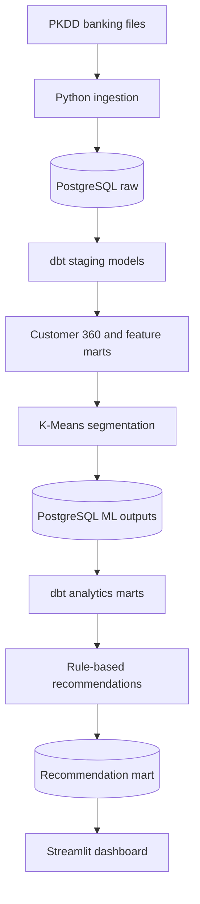

# Banking Customer Segmentation and Product Recommendation Platform

An end-to-end banking analytics platform that transforms anonymized relational banking data into validated data marts, behavioral customer segments, ranked product recommendations, and an interactive Streamlit dashboard.

## Project results

- Processed **1,056,320 banking transactions**
- Built Customer 360 records for **4,500 primary account owners**
- Created **five behavioral customer segments**
- Generated **12,175 ranked recommendations**
- Provided recommendations for all **4,500 modeled customers**
- Created PostgreSQL schemas for raw, staging, analytics, and ML data
- Completed **167 dbt models and data tests with zero errors**
- Automated the complete pipeline through one Python command

## Business questions

- What distinct customer behavior segments exist?
- Which segments demonstrate higher value and engagement?
- Which customers show declining activity or financial volatility?
- Which products or services are relevant for each customer?
- How can marketing teams prioritize campaigns using transparent rules?
- How can recommendation results remain explainable and auditable?

## Architecture



## Technology stack

- Python 3.11
- Pandas and NumPy
- scikit-learn
- PostgreSQL 16
- SQLAlchemy
- dbt-core and dbt-postgres
- Docker Compose
- Streamlit
- Altair and Plotly
- pytest
- Joblib

## Dataset

The project uses the anonymized PKDD'99 Financial dataset. Its relational structure contains:

| Table | Records |
|---|---:|
| Transactions | 1,056,320 |
| Orders | 6,471 |
| Clients | 5,369 |
| Dispositions | 5,369 |
| Accounts | 4,500 |
| Cards | 892 |
| Loans | 682 |
| Districts | 77 |

The source data covers historical banking activity from 1993 through 1998. It is used only for portfolio demonstration and is not presented as current banking activity.

The analytics model contains 4,500 customers because it uses one primary account owner per account. Source customer IDs are not sequential, and secondary account users are excluded to prevent duplicated account behavior.

## Data pipeline

### 1. Raw ingestion

Python loads the eight source files into PostgreSQL’s `raw` schema. Row-count reconciliation verifies that every source record is loaded.

### 2. dbt transformations

dbt performs:

- Type conversion and data cleaning
- Source validation
- Relational joins
- Transaction aggregation
- Account-level feature engineering
- Customer 360 modeling
- ML feature preparation
- Analytics mart creation

The database uses these schemas:

| Schema | Purpose |
|---|---|
| `raw` | Original source data |
| `staging` | Cleaned and standardized records |
| `analytics` | Customer 360 and reporting marts |
| `ml` | Segments, profiles, and recommendations |

### 3. Customer segmentation

The segmentation pipeline uses 14 behavioral features, including:

- Account tenure
- Transaction frequency and volume
- Average transaction amount
- Net cash flow
- Average and latest balances
- Negative-balance activity
- Card withdrawals
- Cash deposits
- Incoming and outgoing transfers

Preprocessing includes:

- First and 99th percentile outlier capping
- Yeo-Johnson transformation
- Standardization
- Reproducible K-Means training with `random_state=42`

Cluster counts from `k=2` through `k=8` are evaluated using inertia, silhouette score, and Davies-Bouldin score. Five clusters were selected after considering quantitative quality, segment size, and business interpretability.

## Customer segments

| Segment | Customers | Percentage |
|---|---:|---:|
| High-Value Multi-Product | 1,464 | 32.53% |
| Everyday Cash-Focused | 1,409 | 31.31% |
| Mature Transfer-Focused | 1,188 | 26.40% |
| High-Flow Financially Volatile | 260 | 5.78% |
| Low-Engagement Dormant | 179 | 3.98% |

The trained model, fitted transformer, feature order, clipping limits, segment names, and descriptions are saved together as a reusable Joblib artifact.

## Product recommendations

The recommendation engine uses transparent rules based on:

- Customer segment
- Existing card and loan ownership
- Transaction activity
- Account balances
- Net cash flow
- Negative-balance activity
- Scheduled payment usage
- Days since the last transaction

It generates up to three ranked recommendations per customer.

Supported recommendation types include:

- Payment Card
- Personal Loan Consultation
- Savings Account
- Overdraft Protection
- Automatic Payment Setup
- Account Re-Engagement Review

A personal loan consultation is only an invitation for human review. It is not an automated credit approval or eligibility decision.

## Recommendation results

- **12,175** recommendations generated
- **4,500** customers covered
- **Zero** duplicate customer-product combinations
- **Zero** missing explanations
- Scores validated between 0 and 100
- Ranks validated between 1 and 3

## Streamlit dashboard

The dashboard provides:

- Total customer and recommendation metrics
- Customer distribution by segment
- Recommendation distribution by product
- Segment balance and product summaries
- Searchable customer-level recommendation explorer
- Recommendation scores, ranks, and explanations

Run the dashboard with:

```powershell
python -m streamlit run dashboards\app.py
```

Then open:

```text
http://localhost:8501
```

## Windows quick start

### 1. Clone the repository and enter the project

```powershell
git clone <repository-url>
cd banking-customer-segmentation
```

### 2. Create the environment file

```powershell
Copy-Item .env.example .env
Copy-Item dbt\profiles.yml.example dbt\profiles.yml
```

Add the required PostgreSQL values to `.env`.

### 3. Start PostgreSQL

```powershell
docker compose up -d postgres
```

The project maps PostgreSQL to host port `5433`.

### 4. Create and activate the Python environment

```powershell
py -3.11 -m venv .venv
.\.venv\Scripts\Activate.ps1
```

### 5. Install dependencies

```powershell
python -m pip install --upgrade pip
pip install -r requirements.txt
```

### 6. Verify the environment

```powershell
python -m src.extraction.check_environment
python -m pip check
```

### 7. Run the complete analytics pipeline

```powershell
python run_pipeline.py
```

The pipeline performs these steps in dependency order:

1. Builds the segmentation feature mart
2. Trains and validates the segmentation model
3. Writes segment assignments and profiles to PostgreSQL
4. Builds the customer-segment mart
5. Generates and validates product recommendations
6. Writes recommendation outputs to PostgreSQL
7. Builds and tests the complete dbt project

Successful execution ends with:

```text
PIPELINE COMPLETED SUCCESSFULLY
```

### 8. Start the dashboard

```powershell
python -m streamlit run dashboards\app.py
```

## Validation commands

Run Python tests:

```powershell
python -m pytest -q
```

Run the complete dbt project:

```powershell
cd dbt
dbt build --profiles-dir .
```

Current dbt result:

```text
PASS=167 WARN=0 ERROR=0 SKIP=0 TOTAL=167
```

## Important outputs

| Output | Location |
|---|---|
| Cluster evaluation | `data/processed/segmentation/cluster_evaluation.csv` |
| Cluster profiles | `data/processed/segmentation/cluster_profiles.csv` |
| Customer assignments | `data/processed/segmentation/customer_cluster_assignments.csv` |
| Recommendation output | `data/processed/recommendations/customer_product_recommendations.csv` |
| Reusable model artifact | `models/segmentation/customer_segmentation_pipeline.joblib` |
| Customer segments table | `ml.customer_segments` |
| Cluster profiles table | `ml.cluster_profiles` |
| Product recommendations table | `ml.product_recommendations` |
| Customer segment mart | `analytics.mart_customer_segments` |
| Recommendation mart | `analytics.mart_product_recommendations` |

## Project structure

```text
banking-customer-segmentation/
├── dashboards/
│   └── app.py
├── data/
│   └── processed/
├── dbt/
│   ├── models/
│   ├── dbt_project.yml
│   └── profiles.yml
├── models/
│   └── segmentation/
├── src/
│   ├── extraction/
│   ├── profiling/
│   ├── recommendations/
│   ├── segmentation/
│   ├── transformation/
│   └── validation/
├── tests/
├── docker-compose.yml
├── requirements.txt
├── run_pipeline.py
└── README.md
```

## Responsible interpretation

Customer segments describe patterns found in this historical dataset. They are not facts about individuals and should not be used for adverse decisions.

The recommendation system:

- Does not use gender, age, or location to determine recommendations
- Uses transparent and reviewable rules
- Does not approve or deny credit
- Provides human-readable recommendation reasons
- Is intended for portfolio and analytics demonstration only

## Future enhancements

- Add Apache Airflow orchestration
- Build a Power BI executive dashboard
- Add recommendation acceptance and conversion tracking
- Add model-drift monitoring
- Add automated GitHub Actions testing
- Deploy the Streamlit application