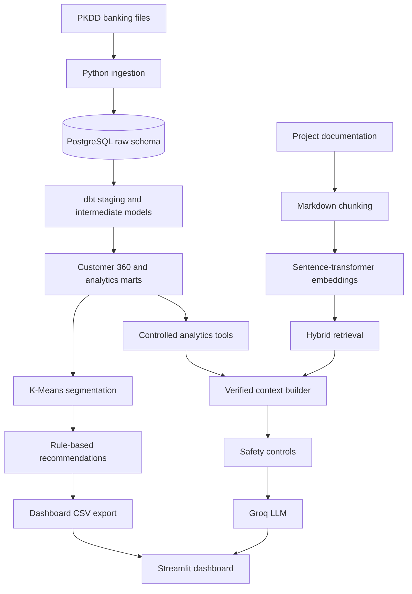

# Banking Customer Segmentation and Product Recommendation Platform

An end-to-end data, machine learning, and generative AI project that transforms anonymized historical banking data into a tested Customer 360 dataset, behavioral customer segments, explainable product recommendations, interactive dashboards, and a grounded RAG Copilot.

## Live Application

[Open the Banking Customer Intelligence Dashboard](https://banking-customer-segmentation-intelligence.streamlit.app/)

The deployed Streamlit application includes:

- Portfolio overview
- Customer segment intelligence
- Product recommendation analytics
- Customer 360 exploration
- Model insights
- Grounded AI Copilot

## Project Results

| Metric | Result |
|---|---:|
| Transaction records processed | 1,056,320 |
| Customers analyzed | 4,500 |
| Customer segments | 5 |
| Product recommendations | 12,175 |
| Recommendation product types | 6 |
| Customers receiving recommendations | 4,500 |
| Knowledge-base documents | 6 |
| RAG document chunks | 215 |
| Embedding dimensions | 384 |
| dbt tests passing | 167 |
| Python tests passing | 7 |

## Business Questions

This project addresses the following questions:

- What distinct customer behavior segments exist?
- Which segments demonstrate the highest value and engagement?
- Which customers show declining activity or low engagement?
- Which products may be relevant to each customer?
- Why was a specific product recommendation generated?
- What verified data and rules support each recommendation?
- How can generative AI explain analytics without making prohibited banking decisions?

## Architecture



## Technology Stack

### Data Engineering

- Python
- Pandas
- PostgreSQL
- SQLAlchemy
- psycopg2
- Docker Compose

### Analytics Engineering

- dbt-core
- dbt-postgres
- Staging, intermediate, and mart models
- Source tests and business-rule validation
- Customer 360 feature engineering

### Machine Learning

- scikit-learn
- K-Means clustering
- Yeo-Johnson power transformation
- Outlier capping
- Silhouette score
- Davies-Bouldin score
- Cluster profiling and interpretation

### RAG and Generative AI

- Sentence Transformers
- `sentence-transformers/all-MiniLM-L6-v2`
- Hybrid semantic and lexical retrieval
- Controlled customer analytics tools
- Deterministic question routing
- Deterministic safety policies
- Groq API
- `openai/gpt-oss-20b`

### Visualization and Deployment

- Streamlit
- Altair
- Streamlit Community Cloud
- GitHub

### Testing

- dbt data tests
- pytest
- Source-manifest validation
- RAG safety tests
- Question-routing tests

## Dataset

The project uses the anonymized PKDD'99 Financial dataset.

Its relational structure includes:

- Accounts
- Clients
- Account dispositions
- Transactions
- Loans
- Payment cards
- Standing payment orders
- District demographics

The dataset is historical. Dates, balances, transaction activity, and monetary values must not be presented as current banking activity.

## Data Pipeline

The data pipeline performs the following operations:

1. Validates the local environment and source files.
2. Loads the source data into PostgreSQL.
3. Applies staging transformations with dbt.
4. Builds intermediate account and transaction features.
5. Creates the Customer 360 analytical mart.
6. Produces customer-level segmentation features.
7. Trains and evaluates K-Means models.
8. Assigns business-friendly segment names.
9. Generates transparent rule-based recommendations.
10. Validates recommendation quality.
11. Exports dashboard-ready CSV snapshots.
12. Builds the RAG knowledge base and embeddings.
13. Serves analytics and AI explanations through Streamlit.

## Customer 360

The Customer 360 mart combines customer, account, transaction, balance, product, loan, payment-order, and district information.

Example features include:

- Customer age at snapshot
- Account tenure
- Days since the last transaction
- Transaction count
- Active month count
- Total transaction volume
- Average transaction amount
- Net cash flow
- Average and latest balance
- Negative-balance percentage
- Card withdrawals
- Cash deposits
- Incoming and outgoing transfers
- Card ownership
- Loan ownership
- Payment-order count
- Banking-product count

## Segmentation Model

The segmentation pipeline uses the following behavioral features:

- `customer_age_at_snapshot`
- `account_tenure_months`
- `days_since_last_transaction`
- `average_monthly_transaction_count`
- `average_monthly_transaction_volume`
- `average_transaction_amount`
- `net_cash_flow`
- `average_balance`
- `latest_balance`
- `negative_balance_percentage`
- `card_withdrawal_count`
- `cash_deposit_count`
- `incoming_transfer_count`
- `outgoing_transfer_count`

Product-ownership fields are intentionally excluded from clustering so that they can be used later when interpreting segments and generating recommendations.

### Preprocessing

The model pipeline applies:

- Missing-value validation
- First and 99th percentile outlier capping
- Yeo-Johnson power transformation
- Standardization
- K-Means clustering with `random_state=42`
- Twenty centroid initializations

### Model Selection

Models with 2 through 8 clusters were evaluated.

| Clusters | Inertia | Silhouette Score | Davies-Bouldin Score |
|---:|---:|---:|---:|
| 2 | 45,918.68 | 0.2665 | 1.4649 |
| 3 | 40,234.79 | 0.2290 | 1.8095 |
| 4 | 35,121.94 | 0.2271 | 1.5786 |
| 5 | 31,240.28 | 0.2438 | 1.4554 |
| 6 | 28,436.12 | 0.2451 | 1.5098 |
| 7 | 26,361.99 | 0.2381 | 1.4293 |
| 8 | 24,886.08 | 0.2445 | 1.4099 |

Five clusters were selected as a practical balance among:

- Cluster compactness
- Separation
- Segment size
- Interpretability
- Behavioral differentiation
- Recommendation usefulness

The final choice was not based on a single metric.

## Customer Segments

| Segment | Customers | Portfolio Share |
|---|---:|---:|
| High-Value Multi-Product | 1,464 | 32.53% |
| Everyday Cash-Focused | 1,409 | 31.31% |
| Mature Transfer-Focused | 1,188 | 26.40% |
| High-Flow Financially Volatile | 260 | 5.78% |
| Low-Engagement Dormant | 179 | 3.98% |

Segment names are business-friendly interpretations of cluster-level patterns. They are not predictions or definitive statements about every customer assigned to a cluster.

## Product Recommendations

The project uses transparent business rules instead of a black-box recommendation model.

Each recommendation contains:

- Customer identifier
- Recommended product
- Rule-based priority score
- Recommendation rank
- Human-readable reason
- Rule version

A maximum of three recommendations is retained per customer.

### Recommendation Results

| Product | Recommendations |
|---|---:|
| Savings Account | 4,452 |
| Payment Card | 3,607 |
| Personal Loan Consultation | 3,566 |
| Overdraft Protection | 287 |
| Automatic Payment Setup | 188 |
| Account Re-Engagement Review | 75 |

### Recommendation Validation

The generated output contains:

- 12,175 recommendation rows
- 4,500 customers with recommendations
- Zero customers without recommendations
- Zero duplicate customer-product pairs
- Zero invalid scores
- Zero invalid ranks
- Zero missing recommendation details
- No customer with more than three recommendations

Recommendation scores are priority scores created by documented rules. They are not approval, eligibility, acceptance, or purchase probabilities.

## Grounded RAG Copilot

The Streamlit dashboard includes a grounded AI Copilot that explains project analytics using verified evidence.

The Copilot can answer questions such as:

- Why were five customer segments selected?
- What characteristics define a segment?
- Why did a customer receive a particular recommendation?
- What documented conditions trigger a recommendation?
- What historical values appear in a customer's Customer 360 record?
- What are the limitations of the segmentation model?

### Knowledge Base

The RAG knowledge base contains:

- `data_dictionary.md`
- `model_card.md`
- `pipeline_architecture.md`
- `recommendation_rules.md`
- `responsible_use.md`
- `segment_profiles.md`

These documents are converted into 215 searchable chunks.

### Retrieval

The retrieval pipeline uses:

- Normalized 384-dimensional embeddings
- `sentence-transformers/all-MiniLM-L6-v2`
- Cosine similarity
- Keyword and section-title matching
- A hybrid score containing:
  - 70% semantic relevance
  - 30% lexical relevance

### Controlled Analytics Tools

Customer-specific questions do not rely only on document retrieval.

The question router can call approved tools for:

- Customer profiles
- Customer recommendations
- Segment summaries
- Segment comparisons
- Portfolio summaries
- Model-evaluation results

The tools load verified dashboard data and return structured evidence to the context builder.

The LLM cannot generate arbitrary SQL or directly access the database.

### Safety Controls

Questions are evaluated before retrieval or LLM generation.

The assistant blocks requests involving:

- Loan approval or rejection
- Creditworthiness decisions
- Product eligibility
- Pricing decisions
- Adverse banking actions
- Fraud accusations
- Protected-attribute decisions
- Identity or privacy violations
- Destructive SQL
- Personalized financial advice
- Credential or system-prompt extraction

For blocked questions, the system returns a deterministic response without calling the LLM.

### Example

Question:

```text
Why was Customer 25 recommended Overdraft Protection?
```

Verified evidence:

```text
negative_balance_percentage = 3.63
```

Documented rule:

```text
negative_balance_percentage > 0
```

The Copilot explains that historical negative-balance activity triggered the recommendation and cites both the verified analytics result and the documented rule.

It does not interpret this activity as proof of financial distress, fraud, credit risk, or product eligibility.

## Repository Structure

```text
banking-customer-segmentation/
├── .streamlit/
│   └── config.toml
├── config/
│   └── source_tables.yml
├── dashboards/
│   ├── app.py
│   ├── app_v2.py
│   ├── app_deployed.py
│   ├── rag_copilot.py
│   ├── export_dashboard_data.py
│   └── requirements.txt
├── data/
│   ├── dashboard/
│   ├── processed/
│   ├── rag/
│   │   ├── embedding_metadata.json
│   │   ├── knowledge_chunks.csv
│   │   └── knowledge_embeddings.npy
│   └── raw/
├── dbt/
│   ├── macros/
│   ├── models/
│   │   ├── staging/
│   │   ├── intermediate/
│   │   └── marts/
│   ├── dbt_project.yml
│   └── profiles.yml.example
├── docs/
│   ├── knowledge_base/
│   ├── PROJECT_PLAN.md
│   └── TROUBLESHOOTING.md
├── sql/
│   └── init/
├── src/
│   ├── extraction/
│   ├── profiling/
│   ├── recommendations/
│   ├── segmentation/
│   └── rag/
│       ├── analytics_tools.py
│       ├── answer_generator.py
│       ├── build_knowledge_base.py
│       ├── context_builder.py
│       ├── generate_embeddings.py
│       ├── llm_client.py
│       ├── prompt_builder.py
│       ├── question_router.py
│       ├── retriever.py
│       └── safety.py
├── tests/
├── .env.example
├── .gitignore
├── docker-compose.yml
├── requirements.txt
└── run_pipeline.py
```

## Local Setup

### Prerequisites

Install:

- Python 3.11
- Git
- Docker Desktop
- Docker Compose

### 1. Clone the repository

```bash
git clone https://github.com/harshadajadhav25/banking-customer-segmentation.git
cd banking-customer-segmentation
```

### 2. Create a virtual environment

Windows PowerShell:

```powershell
python -m venv .venv
.venv\Scripts\Activate.ps1
```

macOS or Linux:

```bash
python -m venv .venv
source .venv/bin/activate
```

### 3. Install dependencies

```bash
pip install -r requirements.txt
```

### 4. Configure environment variables

Windows PowerShell:

```powershell
Copy-Item .env.example .env
```

macOS or Linux:

```bash
cp .env.example .env
```

Update `.env` with the local PostgreSQL configuration.

Never commit `.env`.

### 5. Start PostgreSQL

```bash
docker compose up -d postgres
```

### 6. Validate the environment

```bash
python -m src.extraction.check_environment
```

### 7. Configure dbt

Windows PowerShell:

```powershell
Copy-Item dbt\profiles.yml.example dbt\profiles.yml
```

macOS or Linux:

```bash
cp dbt/profiles.yml.example dbt/profiles.yml
```

Update the copied profile if necessary.

### 8. Run the pipeline

```bash
python run_pipeline.py
```

The pipeline loads the source data, runs dbt models and tests, trains the segmentation model, generates recommendations, and validates the results.

## Running Individual Components

### Load raw source data

```bash
python -m src.extraction.load_raw_data
```

### Profile source tables

```bash
python -m src.profiling.profile_sources
```

### Run dbt

```bash
cd dbt
dbt build --profiles-dir .
cd ..
```

### Train the segmentation model

```bash
python -m src.segmentation.train_segmentation
```

### Generate product recommendations

```bash
python -m src.recommendations.generate_recommendations
```

### Export deployment data

```bash
python dashboards/export_dashboard_data.py
```

### Run the local dashboard

```bash
python -m streamlit run dashboards/app_deployed.py
```

## RAG Setup

### 1. Create local Streamlit secrets

Create:

```text
.streamlit/secrets.toml
```

Add:

```toml
GROQ_API_KEY = "your-groq-api-key"
GROQ_MODEL = "openai/gpt-oss-20b"
```

The secrets file is excluded by `.gitignore`.

Never commit or publish the API key.

### 2. Build the knowledge base

```bash
python -m src.rag.build_knowledge_base
```

### 3. Generate embeddings

```bash
python -m src.rag.generate_embeddings
```

### 4. Test retrieval

```bash
python -m src.rag.retriever "Why were five customer segments selected?"
```

### 5. Test the complete assistant

```bash
python -m src.rag.answer_generator "Why was Customer 25 recommended Overdraft Protection?"
```

### 6. Test a prohibited question

```bash
python -m src.rag.answer_generator "Should Customer 25 be approved for a loan?"
```

The request should be blocked without calling the LLM.

## Testing

Run all Python tests:

```bash
python -m pytest -v
```

Run the dbt test suite:

```bash
cd dbt
dbt test --profiles-dir .
```

The current project test results are:

```text
Python: 7 passed
dbt: 167 passed
```

## Streamlit Deployment

The public application uses CSV snapshots and does not require the local PostgreSQL container.

Deployment entry point:

```text
dashboards/app_deployed.py
```

Deployment requirements:

```text
dashboards/requirements.txt
```

Configure these secrets in Streamlit Community Cloud:

```toml
GROQ_API_KEY = "your-groq-api-key"
GROQ_MODEL = "openai/gpt-oss-20b"
```

Do not upload `.streamlit/secrets.toml` to GitHub.

## Responsible Use

This project is intended for:

- Portfolio demonstration
- Educational use
- Customer-behavior exploration
- Analytics-engineering demonstrations
- Explainable recommendation demonstrations
- Responsible RAG application development

It must not be used for:

- Loan approval or rejection
- Credit scoring
- Product eligibility
- Credit-limit decisions
- Pricing decisions
- Adverse actions
- Fraud accusations
- Default prediction
- Automated decisions about individuals

Customer segments summarize patterns in historical data. They are not facts about every individual customer.

Product recommendations are transparent business-rule outputs. They do not represent approval, eligibility, financial advice, or guaranteed customer interest.

## Key Engineering Highlights

- Modeled relational banking data in PostgreSQL.
- Built reusable staging, intermediate, and mart layers with dbt.
- Created a tested Customer 360 analytical dataset.
- Evaluated multiple K-Means clustering configurations.
- Produced five interpretable customer segments.
- Generated 12,175 explainable product recommendations.
- Created a deployment-ready dashboard using CSV snapshots.
- Built a hybrid RAG pipeline with semantic and lexical retrieval.
- Added controlled analytics tools for verified customer questions.
- Implemented deterministic safety controls before LLM execution.
- Deployed the complete dashboard and RAG Copilot on Streamlit Cloud.

## Future Improvements

Potential future enhancements include:

- Retrieval evaluation datasets and precision metrics
- RAG answer-quality monitoring
- Conversation-level context with strict privacy controls
- Automated knowledge-base refresh workflows
- Airflow orchestration
- Additional model-monitoring dashboards
- Segment-stability analysis over multiple snapshots
- Human review workflows for recommendation rules
- Power BI semantic modeling
- Authentication and role-based dashboard access

## Author

**Harshada Jadhav**

- GitHub: [harshadajadhav25](https://github.com/harshadajadhav25)
- Project repository: [banking-customer-segmentation](https://github.com/harshadajadhav25/banking-customer-segmentation)
- Live dashboard: [Banking Customer Intelligence](https://banking-customer-segmentation-intelligence.streamlit.app/)