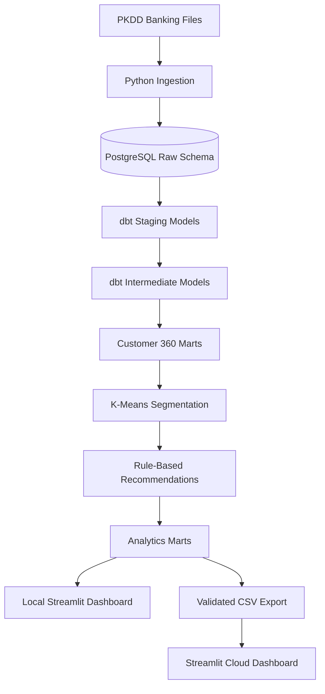
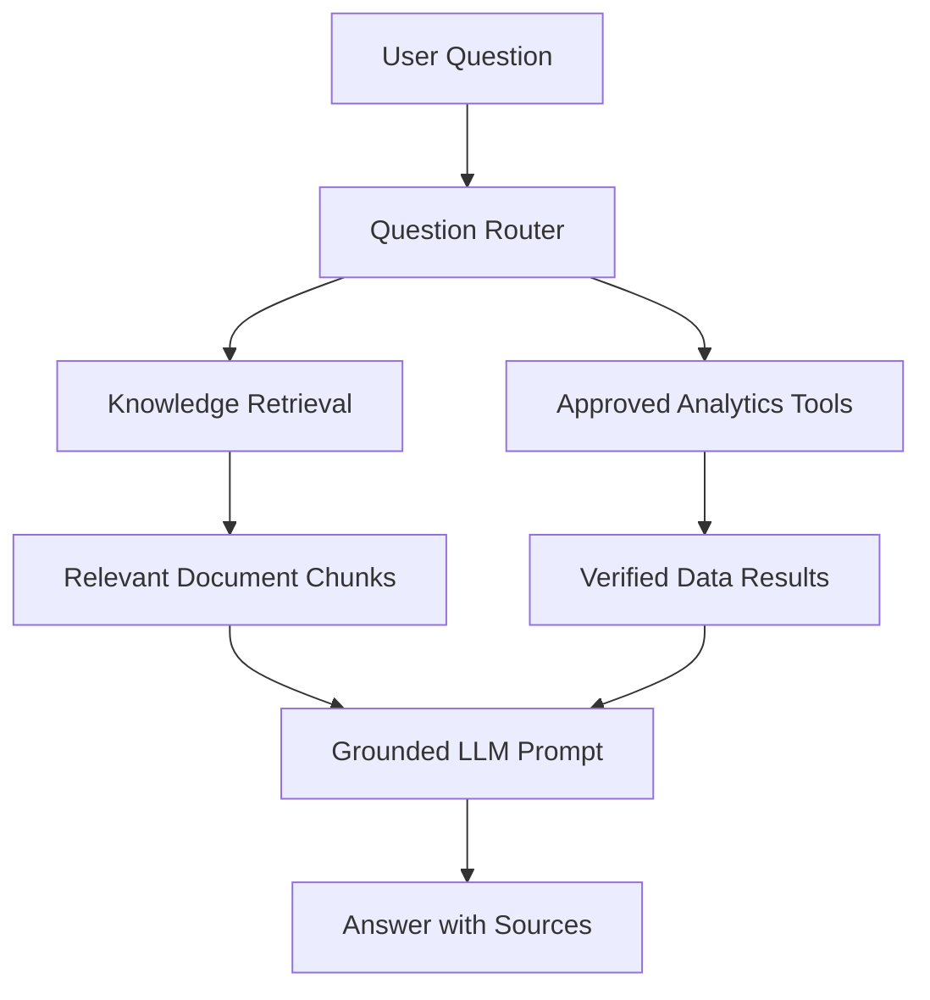

# Banking Analytics Pipeline Architecture

## Purpose

This document explains the end-to-end architecture of the Banking Customer
Segmentation and Product Recommendation Platform.

The platform converts historical anonymized banking data into:

- Validated PostgreSQL source tables.
- Clean dbt staging models.
- Customer 360 analytics features.
- Behavioral customer segments.
- Explainable product recommendations.
- Local and publicly deployed Streamlit dashboards.
- A future RAG-powered banking analytics assistant.

## High-Level Architecture



## Source Dataset

The project uses the anonymized PKDD'99 Czech banking dataset.

The source files represent eight related entities:

| Source | Records |
|---|---:|
| Accounts | 4,500 |
| Cards | 892 |
| Clients | 5,369 |
| Dispositions | 5,369 |
| Districts | 77 |
| Loans | 682 |
| Payment orders | 6,471 |
| Transactions | 1,056,320 |

The dataset is historical. Dates, monetary values, and customer behavior
must not be presented as current banking activity.

## Project Layers

The platform follows a layered analytics architecture:

```text
Source Files
    ↓
Raw PostgreSQL Tables
    ↓
dbt Staging Models
    ↓
dbt Intermediate Models
    ↓
dbt Analytics Marts
    ↓
Machine-Learning Outputs
    ↓
Recommendation Outputs
    ↓
Dashboard and AI Applications
```

## Layer 1: Source Files

The original source files are stored locally under:

```text
data/raw/
```

The files contain anonymized relational banking records.

Raw source files are excluded from Git using `.gitignore`.

The source manifest is configured in:

```text
config/source_tables.yml
```

This configuration defines source filenames, destination tables, and
loading behavior.

## Layer 2: Python Ingestion

The ingestion pipeline is implemented in:

```text
src/extraction/load_raw_data.py
```

Its responsibilities include:

- Reading source files.
- Applying source-specific parsing rules.
- Loading data into PostgreSQL.
- Preserving source record counts.
- Adding ingestion metadata where configured.
- Validating loaded row counts.
- Reporting reconciliation results.

Environment validation is implemented in:

```text
src/extraction/check_environment.py
```

The environment checker verifies required configuration and connectivity
before the pipeline runs.

## Layer 3: PostgreSQL

PostgreSQL is the central data store for local development.

The database is:

```text
banking_analytics
```

The project uses the following schemas:

| Schema | Purpose |
|---|---|
| `raw` | Original ingested source tables |
| `staging` | Cleaned and standardized dbt models |
| `analytics` | Customer 360 and reporting marts |
| `ml` | Machine-learning and recommendation outputs |
| `public` | Default PostgreSQL schema |

PostgreSQL runs locally through Docker.

The container uses PostgreSQL port:

```text
5432
```

The host machine connects through port:

```text
5433
```

The Docker container is named:

```text
banking_analytics_postgres
```

Credentials are loaded from the local `.env` file.

The `.env` file is excluded from Git and must never be committed.

## PostgreSQL Initialization

Database schemas and raw tables are created using:

```text
sql/init/001_create_schemas.sql
sql/init/002_create_raw_tables.sql
```

The Docker Compose configuration is stored in:

```text
docker-compose.yml
```

## Layer 4: dbt Staging Models

dbt transforms raw source tables into standardized staging models.

The source definitions are stored in:

```text
dbt/models/staging/_sources.yml
```

The staging models are:

```text
stg_accounts.sql
stg_cards.sql
stg_clients.sql
stg_dispositions.sql
stg_districts.sql
stg_loans.sql
stg_payment_orders.sql
stg_transactions.sql
```

Staging models are responsible for:

- Renaming source columns.
- Applying consistent data types.
- Standardizing source values.
- Creating business-readable fields.
- Preserving source identifiers.
- Preparing clean inputs for downstream models.

## Layer 5: dbt Intermediate Models

The intermediate transaction model is:

```text
dbt/models/intermediate/int_account_transaction_features.sql
```

It aggregates transaction-level records into account-level behavioral
features.

Examples include:

- Transaction counts.
- Credit and debit amounts.
- Total transaction volume.
- Average transaction amounts.
- Net cash flow.
- Balance statistics.
- Negative-balance activity.
- Card withdrawals.
- Cash deposits.
- Incoming transfers.
- Outgoing transfers.
- First and last transaction dates.

The intermediate layer prevents repeated transaction aggregation in
downstream marts.

## Layer 6: Customer 360 Mart

The main Customer 360 model is:

```text
dbt/models/marts/mart_customer_360.sql
```

It creates one analytics record per primary customer and account
relationship.

The mart combines:

- Customer profile information.
- Account information.
- District context.
- Transaction behavior.
- Balance behavior.
- Card ownership.
- Loan ownership.
- Payment-order activity.
- Banking-product count.
- Snapshot metadata.

The Customer 360 mart is stored as:

```text
analytics.mart_customer_360
```

The current mart contains:

```text
4,500 customer records
```

## Layer 7: Segmentation Feature Mart

The segmentation feature model is:

```text
dbt/models/marts/mart_customer_segmentation_features.sql
```

It prepares customer-level variables required by the K-Means pipeline.

It includes the 14 clustering features:

```text
customer_age_at_snapshot
account_tenure_months
days_since_last_transaction
average_monthly_transaction_count
average_monthly_transaction_volume
average_transaction_amount
net_cash_flow
average_balance
latest_balance
negative_balance_percentage
card_withdrawal_count
cash_deposit_count
incoming_transfer_count
outgoing_transfer_count
```

The database relation is:

```text
analytics.mart_customer_segmentation_features
```

## Layer 8: K-Means Segmentation

The segmentation pipeline is implemented in:

```text
src/segmentation/train_segmentation.py
```

The pipeline:

1. Loads the segmentation feature mart.
2. Validates that clustering features have no missing values.
3. Caps every feature at its 1st and 99th percentiles.
4. Applies a Yeo-Johnson transformation.
5. Standardizes the transformed features.
6. Evaluates K-Means models from `k=2` through `k=8`.
7. Trains the selected five-cluster model.
8. Creates business-readable cluster profiles.
9. Saves model artifacts.
10. Writes assignments and profiles to PostgreSQL.

The selected model uses:

```text
K-Means
5 clusters
random_state = 42
n_init = 20
```

The model version is:

```text
kmeans_v1
```

## Segmentation Outputs

The segmentation pipeline creates:

```text
data/processed/segmentation/cluster_evaluation.csv
data/processed/segmentation/cluster_profiles.csv
data/processed/segmentation/customer_cluster_assignments.csv
```

The saved model artifact is:

```text
models/segmentation/customer_segmentation_pipeline.joblib
```

Database outputs are:

```text
ml.customer_segments
ml.cluster_profiles
```

## Layer 9: Customer Segment Mart

dbt joins the Customer 360 mart with the latest model assignments.

The model is:

```text
dbt/models/marts/mart_customer_segments.sql
```

The resulting relation is:

```text
analytics.mart_customer_segments
```

It contains the complete Customer 360 fields plus:

- Cluster identifier.
- Segment name.
- Segment description.
- Model version.
- Scoring timestamp.

This mart is the primary customer dataset used by the dashboard and
recommendation engine.

## Layer 10: Product Recommendations

The recommendation pipeline is implemented in:

```text
src/recommendations/generate_recommendations.py
```

It uses transparent business rules based on:

- Current product ownership.
- Recent account activity.
- Average monthly transaction frequency.
- Net cash flow.
- Average and latest balances.
- Negative-balance activity.
- Scheduled payment orders.
- Customer segment.

The recommendation version is:

```text
rules_v1
```

The pipeline evaluates six recommendation types:

```text
Payment Card
Personal Loan Consultation
Savings Account
Overdraft Protection
Automatic Payment Setup
Account Re-Engagement Review
```

The pipeline retains a maximum of three recommendations per customer.

## Recommendation Outputs

Recommendations are saved to:

```text
data/processed/recommendations/customer_product_recommendations.csv
```

The machine-learning database output is:

```text
ml.product_recommendations
```

The analytics-ready dbt mart is:

```text
analytics.mart_product_recommendations
```

The current validated output contains:

```text
12,175 recommendations
4,500 customers with recommendations
6 product types
```

## Layer 11: dbt Testing and Validation

dbt YAML files define tests for:

- Required identifiers.
- Unique identifiers.
- Accepted cluster values.
- Required model versions.
- Required timestamps.
- Valid recommendation ranks.
- Valid recommendation scores.
- Recommendation uniqueness.
- Customer coverage.
- Mart integrity.

The completed pipeline currently reports:

```text
PASS=167
WARN=0
ERROR=0
SKIP=0
```

Testing definitions are located throughout:

```text
dbt/models/staging/
dbt/models/marts/
```

## Layer 12: Pipeline Orchestration

The complete local workflow is coordinated through:

```text
run_pipeline.py
```

The pipeline executes the required processing stages in sequence and stops
when a required stage fails.

The overall workflow includes:

1. Environment validation.
2. Raw data ingestion.
3. Source profiling and validation.
4. dbt transformations.
5. dbt tests.
6. Customer segmentation.
7. Product recommendations.
8. Recommendation marts.
9. Final validation.

A successful execution ends with:

```text
PIPELINE COMPLETED SUCCESSFULLY
```

## Layer 13: Local Streamlit Dashboard

The local dashboard is:

```text
dashboards/app_v2.py
```

It reads directly from PostgreSQL.

The local dashboard requires:

- Docker Desktop.
- The PostgreSQL container.
- A configured `.env` file.
- The completed analytics pipeline.

It includes five tabs:

```text
Overview
Segments
Recommendations
Customer 360
Model Insights
```

## Layer 14: Dashboard Data Export

The public Streamlit application cannot connect to a PostgreSQL container
running on a local computer.

The export utility is:

```text
dashboards/export_dashboard_data.py
```

It reads the validated analytics marts and creates:

```text
data/dashboard/customer_segments.csv
data/dashboard/product_recommendations.csv
```

The export validates:

- Customer identifiers.
- Customer uniqueness.
- Segment completeness.
- Recommendation completeness.
- Customer-product uniqueness.
- Recommendation score ranges.
- Recommendation rank ranges.
- Customer-reference integrity.

The current deployment snapshot contains:

```text
4,500 customers
5 segments
12,175 recommendations
4,500 customers with recommendations
```

## Layer 15: Public Streamlit Dashboard

The deployment dashboard is:

```text
dashboards/app_deployed.py
```

It reads the validated CSV snapshot instead of connecting to PostgreSQL.

This allows the application to run on Streamlit Community Cloud without:

- Local Docker.
- Local PostgreSQL.
- Database credentials.
- Public database access.

The public application is available at:

```text
https://banking-customer-segmentation-intelligence.streamlit.app
```

The deployment-specific dependencies are defined in:

```text
dashboards/requirements.txt
```

The Streamlit theme configuration is stored at:

```text
.streamlit/config.toml
```

## Local and Deployed Dashboard Comparison

| Component | Local Dashboard | Deployed Dashboard |
|---|---|---|
| Application | `app_v2.py` | `app_deployed.py` |
| Data source | PostgreSQL | Validated CSV snapshot |
| Docker required | Yes | No |
| `.env` required | Yes | No |
| Publicly accessible | No | Yes |
| Refresh method | Query current marts | Export CSV and push to GitHub |

## Dashboard Data Refresh

When the local pipeline generates updated results, the deployed snapshot
can be refreshed using:

```powershell
python run_pipeline.py
python dashboards\export_dashboard_data.py
git add data/dashboard/
git commit -m "Refresh dashboard data"
git push origin main
```

Streamlit Community Cloud automatically redeploys after updated files are
pushed to GitHub.

## Layer 16: GitHub Actions

GitHub Actions provides continuous-integration checks when code is pushed
or a pull request is opened.

The workflow helps validate:

- Python installation.
- Dependency installation.
- Source-manifest tests.
- Project-level automated checks.

The CI workflow does not contain local database credentials.

## Planned RAG Layer

The RAG pipeline will add a controlled AI interface over project
documentation and approved analytics functions.

The planned flow is:



The knowledge base is stored in:

```text
docs/knowledge_base/
```

The RAG source code will be stored in:

```text
src/rag/
```

Generated chunks and embeddings will be stored in:

```text
data/rag/
```

The RAG assistant will explain:

- Customer segments.
- Recommendation rules.
- Data fields.
- Model evaluation.
- Pipeline architecture.
- Responsible-use requirements.

Customer-specific and numerical questions will use approved analytics
functions rather than unrestricted LLM-generated SQL.

## Security Controls

The project follows these controls:

- `.env` is excluded from Git.
- Database passwords are not stored in source code.
- Local PostgreSQL is not exposed to the public dashboard.
- Raw source files are excluded from Git.
- Public deployment uses a validated analytics snapshot.
- API credentials for the future RAG assistant will use Streamlit secrets.
- The LLM will not receive unrestricted database access.
- The LLM will not generate or execute arbitrary SQL.
- Customer identifiers remain anonymized.

## Responsible Interpretation

The platform is intended for:

- Data-engineering demonstrations.
- Analytics demonstrations.
- Customer-segmentation exploration.
- Explainable recommendation demonstrations.
- RAG and responsible-AI demonstrations.
- Educational and portfolio purposes.

The platform must not be used for:

- Real-world banking decisions.
- Loan approval or rejection.
- Product eligibility.
- Credit scoring.
- Interest-rate or pricing decisions.
- Adverse actions.
- Fraud accusations.
- Claims about protected characteristics.
- Predictions presented as facts about an individual.

All outputs should clearly distinguish between:

- Historical source data.
- Derived customer features.
- Group-level segment patterns.
- Human-created segment labels.
- Rule-based recommendations.
- AI-generated explanations.